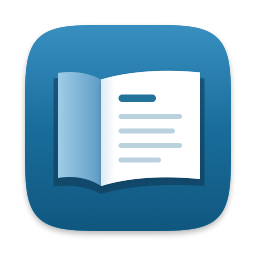
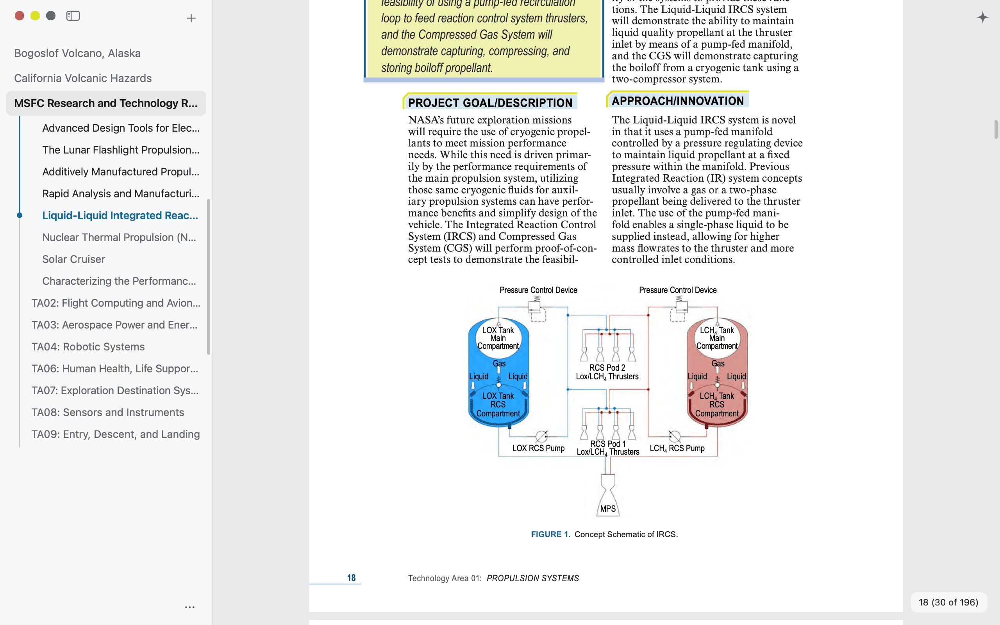
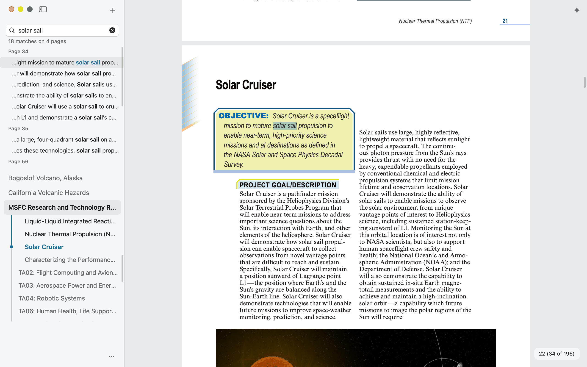
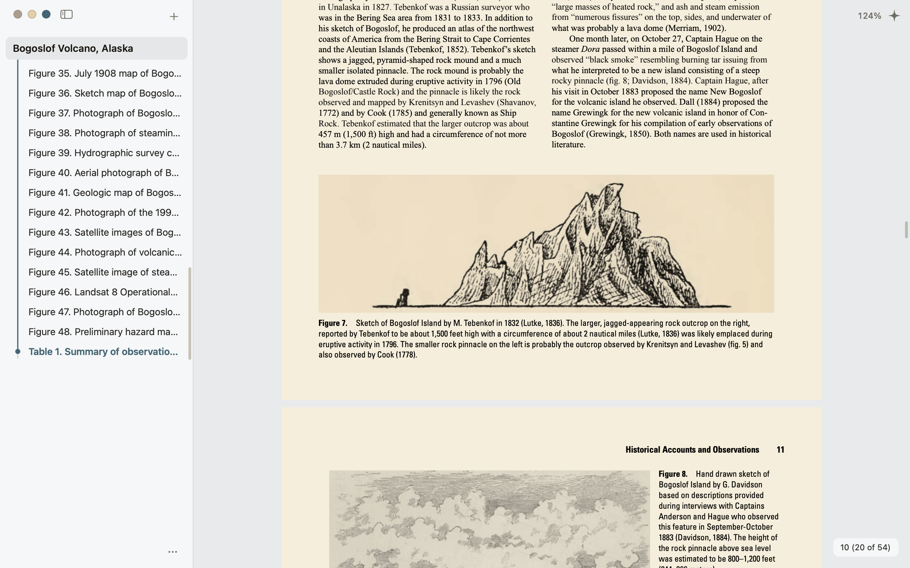
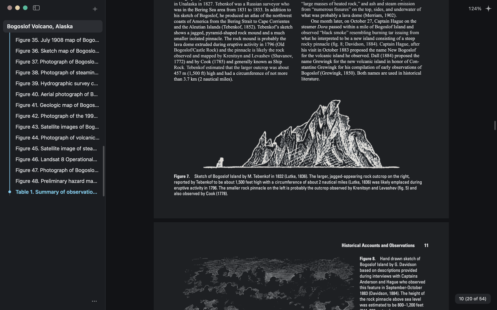
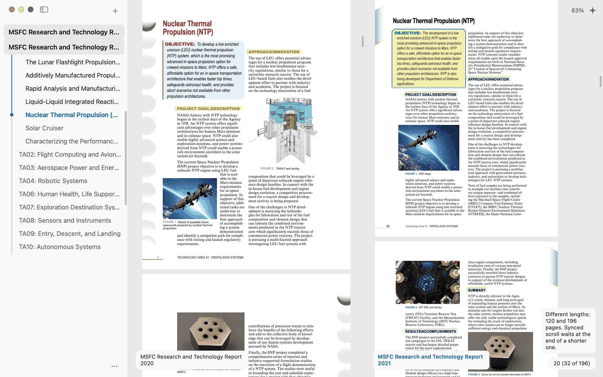

<h1> RectoPDF</h1>

A fast, light PDF reader for the Mac that stays out of the way of the page, keeps everything on your Mac, and can be driven from the command line.

<picture>
  <source media="(prefers-color-scheme: dark)" srcset="docs/images/hero-dark.png">
  
</picture>

*Screenshots are of the real app, made by its own QA tools. The documents are public-domain NASA and USGS reports.*

## Why RectoPDF

- **Fast and light with many large PDFs open.** A tab you aren't looking at is held to 4 KiB of memory, with no file handle and no thread, and measured 0.4 to 0.9 KiB. In the last budget run, 1,000 tabs of a 100 MB, 383-page NASA report added 0.39 MiB over two tabs, the whole app with one text document open used 37 MiB, a cold start showed its first sharp page in 237 ms (median of 11), and the app at rest used about 0% CPU. Measured on a release build on an M4 Mac with 16 GB, in off-screen runs under build load. Every budget, met or missed, is in [`docs/reports/budgets-2026-11-08.md`](docs/reports/budgets-2026-11-08.md).
- **The page gets the window.** There's no toolbar and nothing above the page. Tabs and contents live in a sidebar that hides with one click. The zoom level and page number show when they change, then fade.
- **A native Mac app.** It's built with AppKit, not a web view. Text selection works as it does anywhere on a Mac, and it follows light and dark mode. You can choose white, warm or dark paper. On dark paper, scans and images with a white background turn dark with the page, and photos keep their colours.
- **Private.** It has no account, no analytics and no telemetry. Nothing about your documents leaves your Mac. Its one network request is an anonymous update check to GitHub once a day. See [PRIVACY.md](PRIVACY.md).
- **Safe with untrusted PDFs.** Pages are drawn by PDFium, built with no JavaScript engine and no XFA. It runs in a separate helper process inside the macOS App Sandbox, with no network access, a memory limit and a deadline for each page. Links to web pages open only after you confirm the address. `file:` links, `javascript:` links and launch actions never open.
- **Saving never damages a file.** Saves are atomic, so a file is never left half-written. Added things go on the end of the file, and the bytes already there stay as they were. Deleting pages rewrites the file, so what you deleted is really gone. Your undo history is kept outside the PDF, survives a quit or an update, and is never written into the file. A signed PDF's signed bytes are never changed. If an edit can't be saved without breaking a signature, Save turns off, and Save As makes an unsigned copy and tells you so.
- **Scriptable.** The `recto` command line reads, searches and works with the PDFs open in the app, for your scripts and AI agents. Agent access is off until you raise it yourself.
- **Open source** under the MIT license.

## Install

1. Download `RectoPDF-0.1.0.zip` from the [latest release](https://github.com/kkollsga/RectoPDF/releases/latest).
2. Unzip it and drag **RectoPDF** to your Applications folder.
3. Open it. Releases are signed with a Developer ID and notarized by Apple, so macOS opens them without a warning.

**Requirements:** macOS 15 Sequoia or later, on a Mac with Apple silicon (M1 or later). Intel Macs aren't supported.

**Updates.** RectoPDF checks GitHub for a new release once a day. *Update automatically* is in **RectoPDF › Settings…** (⌘,) and is on by default. With it on, an update installs once you haven't touched the app for 30 minutes, and the app comes back exactly as you left it. With it off, the **RectoPDF** menu offers *Update to X.Y.Z…*, which you can choose at any time. *Check for Updates…* in the same menu checks right away.

**Uninstalling.** Quit RectoPDF and move it to the Bin. To also remove its settings, history and caches, follow [PRIVACY.md › Deleting it](PRIVACY.md#deleting-it).

## Using it

### Opening files and tabs
- Open a PDF with **File › Open…** (⌘O) or the **+** at the top of the sidebar. You can also drop PDFs on the window or use Finder's *Open With*.
- Each PDF opens as a tab in the sidebar. A PDF can only be open once: opening it again takes you to its tab.
- **File › Open Recent** lists the last 20 files you opened. ⌘W closes the tab you're reading.

### The sidebar and contents
- Click the sidebar button beside the window controls, or press ⌃⌘S, to show or hide the sidebar. With the sidebar hidden, the window controls fade until you point at them.
- The active tab shows its contents. The contents follow your place as you read, and a chevron folds a section. Clicking the active tab folds or opens its contents.
- If a PDF has no contents, or only bad ones, the sidebar offers **Generate contents**. This builds a list of contents from the document's headings, on your Mac, and labels it as generated. The file's own contents are never changed.

### Find and the command palette
- **⌘F** opens Find in the sidebar. Results come in as they're found, grouped by page. Return or ⌘G goes to the next result, ⇧⌘G to the previous one, and Escape closes Find.
- **⌘K** opens the command palette. A few letters find any command or open tab: `zi` finds Zoom In. The palette shows each command's menu and shortcut.



### Zoom and layout
- Zoom with ⌘+ and ⌘−, plain + and −, ⌘-scroll or a pinch. **View › Actual Size** (⌘0) shows the page at its real size, and **Fit** (⌘9) fits it to the window.
- Click the zoom level in the top right to type a level.
- Right-click a page to choose **Single Page**, **Side by Side**, or **Side by Side, First Page Alone** (for books with a cover). The same choices are in the View menu.
- Click the page number in the lower right, or choose **Go › Go to Page…**, to jump to a page by its number or by the page's own label, such as `iv`. ⌘[ and ⌘] go back and forward through jumps.

### Paper colours
- **View › Paper** has White, Warm and Dark. Until you choose one, the paper follows the window: white in light mode, dark in dark mode.
- Paper colour changes only the screen. Printing, copying and saving always use the page's true colours.




### Comparing PDFs side by side
- ⌘-click or ⌃-click a tab in the sidebar to show it beside the one you're reading, up to three at a time. Click a tab normally to go back to one.
- Right-click a page and choose **Synced Scroll** to scroll the panes together, page for page. **Separate Scroll** is the default. All the panes always share one zoom.



### Selecting and copying text
- Drag to select across lines and pages. Double-click selects a word, triple-click a line, and ⌘A the whole document. ⌘C copies.
- Copied body text leaves out running headers, footers and page numbers, even across page breaks.
- If a PDF asks not to be copied, RectoPDF tells you and offers **Copy anyway**.

### Snapshots
- **Tools › Snapshot** (⇧⌘A), or Snapshot in the sidebar's **⋯** panel, turns the snapshot tool on. Text selection comes back when you turn it off or open another tab.
- Click an image on the page to copy it without loss, in its original bytes where it's a JPEG.
- Drag a box to put it on the clipboard as PNG, text, SVG and JPG all at once.

### Rotating and editing pages, then saving
- The sidebar's **⋯** panel has **Rotate left** and **Rotate right**. They turn every page together, which fixes a sideways scan.
- Edit › Undo (⌘Z) and Redo (⇧⌘Z) work on edits, and go back past a save.
- In 0.1.0, deleting, inserting and moving pages is done with the `recto` command line, at Control access: `recto page delete`, `recto page insert` and `recto page move`. The app shows the edits, and saves them like any other.
- A file with unsaved changes shows a dot in the red window button and a Save icon beside the window controls. **File › Save** (⌘S) saves into the file, and **Save As…** (⇧⌘S) saves a new file. Closing asks whether to save.
- Your first save keeps a backup of the original. **Edit › Clear Edit History** deletes a document's undo history.

### Printing
- **File › Print…** (⌘P) prints the document's real pages at 300 dpi, never the screen's picture of them. Paper colour never prints, and pages you've rotated print rotated.

### Picking up where you left off
- Quit and reopen RectoPDF, or let it update, and it comes back as you left it: the same tabs, the same place in each, zoom, layout, Find, and any unsaved edits with their undo history.
- A password-protected PDF asks for its password again, as passwords are never stored. A file that was moved or changed while the app was closed is shown as moved or changed.

## The `recto` command line

`recto` is a small program inside the app that lets scripts and AI agents work with the PDFs open in RectoPDF. It talks to the running app through a private connection that only your user account can open, and it never listens on the network. Every command it runs goes into an activity log.

**Put it on your PATH.** It lives at `RectoPDF.app/Contents/MacOS/recto`. Link it from a folder on your PATH, and updates keep the link working:

```sh
sudo mkdir -p /usr/local/bin
sudo ln -s /Applications/RectoPDF.app/Contents/MacOS/recto /usr/local/bin/recto
recto status
recto help
```

**Access levels.** Agent access is **Off** by default. At Off, a program can see how many PDFs are open and nothing else. You raise the level yourself, in your own terminal, by typing back a word that changes every time, so a program can't raise it for itself:

```sh
recto permission set read_only   # read and search open documents
recto permission set control     # also open, move around, edit pages and save edits
recto permission set full        # also write exports to disk and rewrite files
recto permission set off         # lowering needs no confirmation
```

`recto permission show` lists what each level allows. Signing is never allowed at any level. Read the full table in [PRIVACY.md](PRIVACY.md#other-programs-agent-access).

**A few commands:**

```sh
recto tabs                          # the open tabs, with page and length
recto search "solar sail" --rank    # the pages most about these words, best first
recto text 34                       # one page's text, with headers and footers marked
recto page rotate all --by 90       # an unsaved edit, shown in the app; `recto undo` takes it back
recto skill install                 # write a skill file for your AI agent, after you confirm
```

Text read from a PDF comes back marked as untrusted, so an agent can tell a document's words from instructions. `recto help <command>` explains any command, and every command takes `--json`.

## Building from source

You need a Mac with Apple silicon and macOS 15 or later, Swift 6 (from Xcode or the Command Line Tools), and Rust through [rustup](https://rustup.rs). `rust-toolchain.toml` pins the compiler, so rustup installs the right one.

```sh
git clone https://github.com/kkollsga/RectoPDF.git
cd RectoPDF
app/build.sh            # debug build: app/build.noindex/RectoPDF.app
app/build.sh --release  # the optimised build the budgets are measured on
```

`app/build.sh` runs `tools/pdfium.sh` first. That downloads PDFium (no V8, no XFA) from [bblanchon/pdfium-binaries](https://github.com/bblanchon/pdfium-binaries) and checks it against pinned digests. A local build is signed ad hoc and never updates itself. `tools/check.sh --quick` runs the fast tests.

The architecture and each crate are described in [`docs/ENGINEERING.md`](docs/ENGINEERING.md), the behaviour in [`SPEC.md`](SPEC.md), and how releases are signed and published in [`docs/RELEASING.md`](docs/RELEASING.md).

## Privacy, license and credits

- **Privacy:** [PRIVACY.md](PRIVACY.md) says what RectoPDF sends (one update check a day), what it keeps on your Mac, and how to delete it.
- **License:** MIT, see [LICENSE](LICENSE).
- **Third-party software:** PDFium, a fork of [lopdf](https://github.com/kkollsga/lopdf) and the other components, with their licenses, are listed in [THIRD-PARTY-NOTICES.txt](THIRD-PARTY-NOTICES.txt). The app includes the same notices as `Licenses.txt`.
- **Issues and releases:** [github.com/kkollsga/RectoPDF](https://github.com/kkollsga/RectoPDF).
